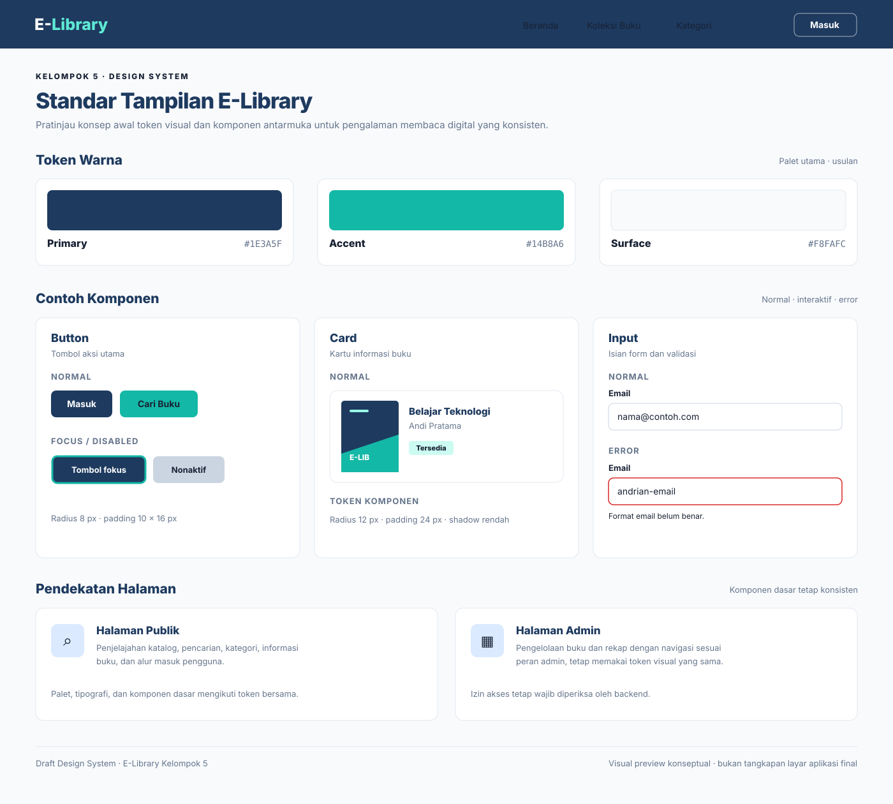

# Tugas Kelompok 1 — Design System E-Library

**Versi:** 1.0
**Status:** Baseline Design System v1, kode komponen, dan bukti visual render preview telah disiapkan. Preview merupakan demonstrasi UI statis dan belum terintegrasi dengan API.

## 1. Tujuan
Menyepakati token visual dan pola komponen bersama agar halaman publik dan admin E-Library terlihat konsisten.

## 2. Token visual versi 1
Token berikut dipakai sebagai baseline awal implementasi. Jika tim menemukan kebutuhan teknis atau aksesibilitas yang lebih baik, revisi dapat dilakukan melalui Pull Request.

### Warna utama
| Token | Hex | Penggunaan |
|---|---|---|
| Primary | `#1E3A5F` | Navigasi utama, tombol utama, judul yang ditekankan |
| Accent | `#14B8A6` | Aksen, indikator terpilih, elemen pendukung |
| Surface | `#F8FAFC` | Latar halaman dan area konten |

Warna error adalah warna status semantik, bukan warna merek utama. Untuk validasi input digunakan `#DC2626` dengan pesan kesalahan yang jelas.

### Tipografi
- **Font judul:** Inter, bobot 600–700.
- **Font isi:** Inter, bobot 400–500.
- **Fallback:** sans-serif sistem jika Inter tidak tersedia.

### Radius sudut
- Kecil: `4px`
- Sedang: `8px`
- Besar: `12px`

### Skala spacing
Gunakan kelipatan 4 px: `4, 8, 12, 16, 24, 32, 48 px`.

### Shadow
- Elevasi rendah untuk kartu: `0 1px 3px rgba(15, 23, 42, 0.10)`
- Elevasi menengah untuk dropdown/modal: `0 8px 24px rgba(15, 23, 42, 0.12)`

## 3. Pendekatan komponen
**Keputusan baseline:** gunakan komponen yang dapat dipakai ulang untuk Button, Card, dan Input. Gunakan utility/style helpers untuk layout, grid, flex, dan spacing sederhana.

Alasannya, komponen interaktif memiliki tampilan dan state yang konsisten, lebih mudah diuji, serta bisa digunakan kembali. Utility tetap digunakan untuk tata letak supaya tidak membuat komponen baru untuk setiap variasi jarak.

## 4. Contoh komponen dan kode
Contoh ini adalah HTML/CSS netral dan dapat diadaptasi ke framework web yang disepakati.

### Button
**Normal state**
```html
<button class="button button-primary">Masuk</button>
```

**Style dan state interaktif**
```css
.button {
  border: 0;
  border-radius: 8px;
  padding: 10px 16px;
  font: 600 1rem/1.4 Inter, sans-serif;
  cursor: pointer;
}
.button-primary { color: #fff; background: #1E3A5F; }
.button-primary:hover { filter: brightness(1.12); }
.button-primary:focus-visible {
  outline: 3px solid #14B8A6;
  outline-offset: 2px;
}
.button:disabled { opacity: .5; cursor: not-allowed; }
```

State yang harus diperiksa: normal, hover/focus, dan disabled.

### Card
**Normal state**
```html
<article class="book-card">
  <h3>Belajar Teknologi</h3>
  <p>Andi Pratama</p>
</article>
```

**Style**
```css
.book-card {
  padding: 24px;
  border-radius: 12px;
  background: #fff;
  box-shadow: 0 1px 3px rgba(15, 23, 42, 0.10);
}
```

Gunakan hover/focus bila kartu dapat dipilih atau diklik.

### Input
**Normal state**
```html
<label for="email">Email</label>
<input id="email" type="email" placeholder="nama@contoh.com" />
```

**Style dan error state**
```css
.input {
  width: 100%;
  padding: 10px 12px;
  border: 1px solid #CBD5E1;
  border-radius: 8px;
  font: 400 1rem Inter, sans-serif;
}
.input:focus-visible { outline: 3px solid #14B8A6; }
.input[aria-invalid="true"] { border-color: #DC2626; }
```

```html
<label for="email-error">Email</label>
<input id="email-error" class="input" type="email"
       aria-invalid="true" aria-describedby="email-help" />
<p id="email-help">Format email belum benar.</p>
```

## 5. Pendekatan halaman publik dan admin
- Gunakan palet, tipografi, radius, spacing, dan komponen dasar yang sama.
- **Halaman publik** berfokus pada penjelajahan katalog, pencarian, kategori, informasi buku, dan alur masuk pengguna.
- **Halaman admin** berfokus pada pengelolaan buku dan rekap; navigasi dan fitur menyesuaikan role admin.
- Tampilan navigasi bukan pengganti otorisasi. Izin akses tetap harus diverifikasi oleh backend.

## 6. Bukti visual
Berikut bukti visual hasil render preview HTML/CSS untuk Button, Card, dan Input. Gambar memperlihatkan state yang dicontohkan; ini adalah preview UI statis, bukan bukti pengujian integrasi API.



- [Buka pratinjau HTML/CSS](../frontend/web/design-system-preview.html)
- [Buka file SVG pratinjau lengkap](assets/design-system-preview.svg)
- [Bukti visual Button — normal, focus, dan disabled](assets/design-system-button-states.png)
- [Bukti visual Card buku](assets/design-system-card.png)
- [Bukti visual Input — normal dan error](assets/design-system-input-error.png)

Bukti visual komponen di atas memperlihatkan kondisi normal, focus/disabled, dan error yang dicontohkan. Gunakan preview HTML untuk memeriksa ulang style jika diperlukan.

## 7. Keputusan baseline
- Warna: Primary `#1E3A5F`, Accent `#14B8A6`, Surface `#F8FAFC`.
- Font: Inter untuk judul dan isi, dengan fallback sans-serif.
- Radius: `4px`, `8px`, `12px`.
- Spacing: skala 4 px, dari `4px` sampai `48px`.
- Shadow: elevasi rendah `0 1px 3px rgba(15, 23, 42, 0.10)` dan elevasi menengah `0 8px 24px rgba(15, 23, 42, 0.12)`.
- Pendekatan: komponen reusable untuk Button/Card/Input, utility untuk layout.
- Halaman publik dan admin: token visual sama, navigasi dan fitur berbeda sesuai kebutuhan dan role.

## 8. Checklist
- [x] Token 2–3 warna utama dengan kode hex tersedia.
- [x] Font judul dan isi ditetapkan sebagai baseline.
- [x] Radius, spacing, dan shadow ditetapkan sebagai baseline.
- [x] Kode contoh Button, Card, dan Input tersedia.
- [x] State normal, interaktif, dan error dijelaskan dalam contoh.
- [x] Pendekatan komponen serta perbedaan halaman publik/admin didokumentasikan.
- [x] Mockup visual acuan dibuat.
- [x] Bukti visual render preview untuk Button, Card, dan Input ditambahkan.
- [x] Bukti visual komponen sudah ditambahkan ke folder `docs/assets/`.
- [x] Dokumen, kode contoh, dan bukti visual diperiksa di repository; Tugas Kelompok 1 siap ditutup.